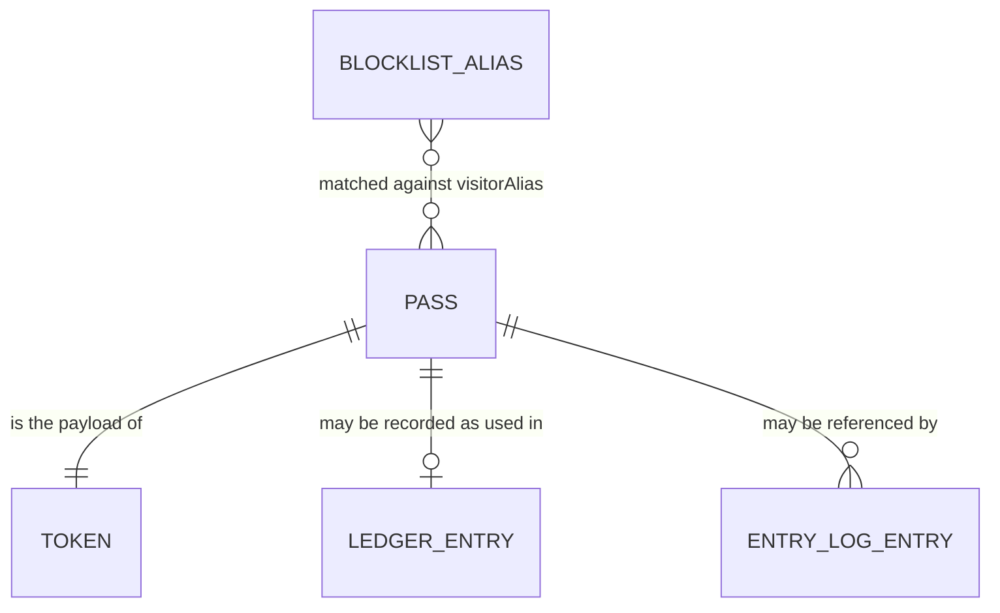

# Data Model

## Overview

All data is fake demo data. There is no database and no backend (see `infrastructure-architecture.md`, C-4). Records live in code, inside a signed token, or in the browser's `localStorage`. This document covers every entity of increment 1 (`prd.md`). All five entities are net-new; nothing is inherited. The Pass (E-1) is not stored on its own: it travels inside the Token (E-2). The Blocklist (E-3) is a fixed list in code. The Ledger (E-4) and the Entry log (E-5) are the only stored data, and both are single-device.

## Entity Relationship Diagram

## Entities

### E-1: Pass

| Field | Type | Constraints | Notes |
| --- | --- | --- | --- |
| `v` | `1` | Required | Format version |
| `id` | string | Required, unique | UUID |
| `unit` | string | Required | One of the 12 demo units |
| `type` | `"one-time"` or `"date-range"` | Required | |
| `validFrom` | string | Required | ISO 8601 UTC |
| `validUntil` | string | Required. Must not be before `validFrom`. | ISO 8601 UTC. This instant is inside the window (`prd.md`, D-1). |
| `visitorAlias` | string | Required, 2 to 24 characters after trimming | Nickname or initials. Never a legal name. |

- **Ownership / source of truth:** The resident's browser creates it (`createPass` in `src/domain/pass.ts`). The signed token is the only copy.
- **Lifecycle:** Created by F-1 (resident form, PG-1). Carried in the token by F-2. Read by the verify route when F-3 is built.
- **Deletion model:** Not stored, so nothing is deleted. The pass exists only inside the token that was shared.

### E-2: Token

| Field | Type | Constraints | Notes |
| --- | --- | --- | --- |
| payload | string | Required | `base64url(JSON of E-1)` |
| signature | string | Required | `base64url(ECDSA P-256 / SHA-256 signature)` over the ASCII bytes of the payload segment |

The token is `base64url(JSON payload) + "." + base64url(signature)`. A verifier needs only the public key (ADR 0001, `.athanor/docs/adr/0001-signed-token-pass.md`).

- **Ownership / source of truth:** Signed in the resident's browser (`src/services/signing.ts`) with the demo private key in `src/data/demo-keys.ts`.
- **Lifecycle:** Created and signed by F-1. Shown as a QR code and as a verify link by F-2. Never stored by the app.
- **Deletion model:** Not stored by the app. A shared token cannot be recalled. There is no revoke feature; the administrator uses the blocklist instead (`prd.md`, D-2).

### E-3: Blocklist

| Field | Type | Constraints | Notes |
| --- | --- | --- | --- |
| alias | string | Required | A fake blocked visitor alias. Matching is by alias (`prd.md`, assumptions). Order in the policy: `prd.md` R-6. |

- **Ownership / source of truth:** `src/data/blocklist.ts`, a fake list. It is demo data.
- **Lifecycle:** Edited in code. Read by `isBlocked` in `src/domain/blocklist.ts`. How a real list would reach every phone is out of scope for this demo.
- **Deletion model:** Not applicable. It is a list in the source code.

### E-4: Ledger (used passes)

| Field | Type | Constraints | Notes |
| --- | --- | --- | --- |
| pass `id` (key) | string | Unique within the map | Refers to E-1 `id` |
| used-at time (value) | string | Required | ISO time the pass was used |

A map from pass `id` to the time the pass was used. Storage key: `na.ledger.v1`. Single device only.

- **Ownership / source of truth:** The browser's `localStorage` on the device that verifies (`src/services/ledger.ts`).
- **Lifecycle:** Written by `markPassUsed` when a one-time pass is granted, and only then (`prd.md`, D-7). Date-range passes never write it. If the write fails, the pass is denied (`prd.md`, D-12). Nothing writes it yet because F-3 is not built. Read by the one-time check.
- **Deletion model:** Retained until the user clears site data. The app has no delete function.

### E-5: Entry log

| Field | Type | Constraints | Notes |
| --- | --- | --- | --- |
| `at` | string | Required | ISO 8601 UTC time of the attempt |
| `result` | `"granted"` or `"denied"` | Required | |
| `reason` | string | Required | Short text |
| `passId` | string | Optional | A token with a bad signature has no trusted fields. |
| `unit` | string | Optional | Same as above |
| `visitorAlias` | string | Optional | Same as above |

A list of entries in storage key `na.entries.v1`, single device only. CSV columns: `at,result,reason,passId,unit,visitorAlias`.

- **Ownership / source of truth:** The browser's `localStorage` on the device that verifies (`src/services/entry-log.ts`).
- **Lifecycle:** Appended by `appendEntry`, one entry per verification attempt, including every reload of a verify link (`prd.md`, D-9). `reason` is one of the fixed texts in `prd.md` R-6. A failed log write never changes the screen (`prd.md`, D-12). Nothing writes entries yet because F-3 is not built. Read and exported as CSV by F-4 (PG-2).
- **Deletion model:** Retained until the user clears site data. The app has no delete function.

## Relationships

- **E-1 Pass to E-2 Token:** One to one. The token payload is the pass.
- **E-1 Pass to E-4 Ledger:** Zero or one ledger record per pass, by pass `id`. No cascade.
- **E-1 Pass to E-5 Entry log:** A pass may appear in many entries, by `passId`. The reference is optional and no cascade applies.
- **E-3 Blocklist to E-1 Pass:** Matched by `visitorAlias`, because aliases are all we store.

## Migration Strategy

- **Tooling:** None. There is no database.
- **Backward-compatible vs. breaking change policy:** Not stated in discovery. Storage keys carry a version suffix (`.v1`) and the pass has a format version (`v`).
- **Backfill approach for existing data:** Not applicable. The project is greenfield.
- **Rollback plan for a failed migration:** Not stated in discovery. No migration exists.

## Data Classification & Privacy

- **PII / sensitive fields:** `visitorAlias` (an alias, never a legal name, per the board's privacy concern) and `unit` (a demo unit). All data is fake.
- **Retention / deletion requirements:** Not stated in discovery. Today, ledger and log stay until site data is cleared.
- **Cross-border / residency constraints:** Not stated in discovery.

## Indexing & Query Patterns

- **Access patterns this schema must serve well:** Look up a pass `id` in the ledger. Check an alias against the blocklist. List all entries and export them as CSV.
- **Indexes added and why:** None. There is no database.
- **Query patterns intentionally left unindexed:** The entry log is read as a whole list. Demo data only. Ledger and log are per device and per browser profile.
