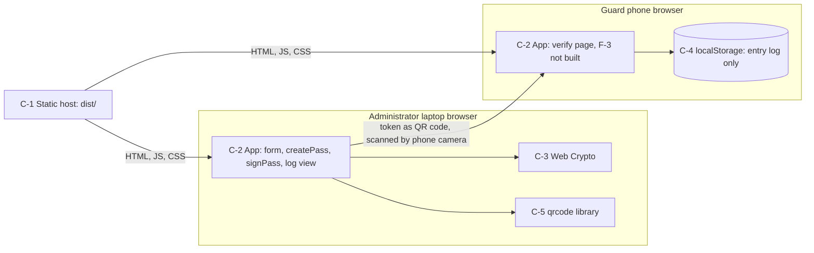
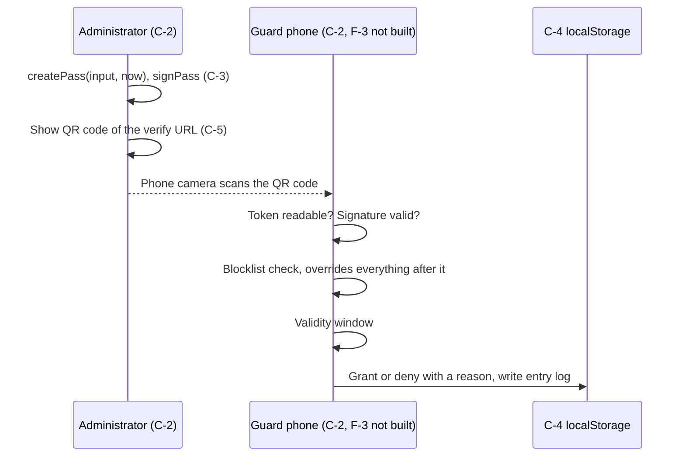

# Infrastructure Architecture

## Overview

A static single-page app for Contoso HQ visitor access. No backend, no database, no accounts. Everything runs in the user's browser. Any static host can serve the built files (`dist/`). The only persistent data is the entry log, which lives in the browser's `localStorage` on each device. The design goals come from `.athanor/docs/discovery/constraints.md`: no server, almost no running cost, and a web page instead of an app-store install (G-5).

## Assumptions

- **Environment count/naming:** Not stated in discovery. CI builds the app; no hosted environment is named.
- **Domain/tenant model:** Single company (Contoso HQ, four buildings), no tenants, no accounts (NG-1).
- **Team size/operational constraints:** IT does not want to run, secure or pay for a server (`constraints.md`).
- **Traffic/usage assumptions:** One administrator on a laptop and guards on company phones, recent iPhones and mid-range Android (`constraints.md`). No load figure is stated.

## Infrastructure Diagram

The token crossing from the administrator's screen to the guard's phone is the one trust boundary (SC-4). In the demo, the QR code on the laptop screen is scanned with a phone. That simulates the guard scanning the visitor's code at the lobby.

## High-Level Architecture

### Components

#### C-1: Static host

- **Role:** Serves the built HTML, JS and CSS.
- **Technology/service:** Any static host (`dist/` from `vite build`). The host is not chosen.
- **Key responsibilities:** Serving files only. It holds no data and runs no logic.
- **Notes:** Cost: near zero.

#### C-2: Browser app

- **Role:** Runs all logic: pass creation, signing, QR, log view, and (F-3) verification.
- **Technology/service:** Single-page app in plain TypeScript, hash routes `#/` and `#/log`, and the verify link `<origin><path>?p=<token>` (PG-1 to PG-3).
- **Key responsibilities:** Domain rules (`src/domain`, pure, time as a parameter, ADR 0002), services, UI. It owns no server-side state. The verify page has no navigation.
- **Notes:** Verification is not built yet. The verify route shows "Verification is not implemented yet".

#### C-3: Web Crypto API

- **Role:** Signs and verifies tokens.
- **Technology/service:** Browser Web Crypto, ECDSA P-256 with SHA-256. No crypto library.
- **Key responsibilities:** Signing in the administrator's browser, signature check in the guard's browser. A verifier needs only the public key (ADR 0001).
- **Notes:** The demo key pair is committed to the repo (SC-4).

#### C-4: Browser localStorage

- **Role:** Holds the entry log (E-4, key `na.entries.v1`). It holds nothing else.
- **Technology/service:** Browser `localStorage` behind a small key-value interface (`src/services/storage.ts`).
- **Key responsibilities:** Storing entry records on one device.
- **Notes:** Per device and per browser profile. Clearing site data erases it.

#### C-5: `qrcode` library

- **Role:** Draws the QR code for the verify URL.
- **Technology/service:** `qrcode` npm package, the only runtime dependency.
- **Key responsibilities:** QR rendering only.
- **Notes:** None.

## Environment Topology

Not stated in discovery. The only built artifact is `dist/`, and no environment or hosting target is named. Whether a UAT environment is adopted is recorded in `tech-stack-and-repo-strategy.md` § Branch and PR Strategy.

## Networking and Security

- **Transport/encryption:** Not stated in discovery. The token travels from the administrator's screen to the guard's phone as a QR code.
- **AuthN/AuthZ boundaries:** None. There are no accounts and no sign-in. Trust in a pass comes from its signature (ADR 0001, `.athanor/docs/adr/0001-signed-token-pass.md`).
- **Secret management:** There are no secrets. The demo key pair is committed on purpose and is demo-only.
- **Data access rules:** Only the app in the browser reads and writes C-4.
- **Trust-boundary notes:** The token is the only thing that crosses between devices. The signature stops anyone editing the building, dates or visitor name.

## Security & Compliance

- **Frameworks in scope:** None stated in discovery. No framework is named in `.athanor/docs/discovery/constraints.md`.
- **Data classification:** Visitor name (E-1, E-4) and building are the only personal-style fields. They sit in the token and in C-4. All data is fake demo data. Visitor names are personal data, so real names are not stored (`constraints.md`).

| # | Framework | Control | How this system meets it | Component(s) | Owner |
|---|---|---|---|---|---|
| SC-1 | None (project rule) | User-provided text must not run as code in the page | Every user string reaches the DOM through `textContent`. Never `innerHTML`. | C-2 | Tech lead |
| SC-2 | None (project rule) | CSV export must not run formulas in a spreadsheet | Cells that start with `=`, `+`, `-` or `@` are neutralised in the export. | C-2 | Tech lead |
| SC-3 | None (project rule) | No secrets and no personal data in the repo. No real names. | Fake data only. No secrets in the repo. Visitor names are fake. | C-2, C-4 | Tech lead |
| SC-4 | None (project rule) | A pass cannot be forged or edited | ECDSA P-256 / SHA-256 signature over the payload (ADR 0001). Exception: the demo private key is committed and ships in the bundle, so anyone can forge a pass. Acceptable only for the demo. A real launch needs a different key custody model, which discovery does not cover. | C-2, C-3 | Tech lead |

Every row appears as its own non-functional requirement in `prd.md` (R-10 to R-13).

## Data Flows (Per Critical Path)

The verification flow is not built yet. There is no pass store to check, so the whole decision comes from the token, the blocklist and the time. The verify link is `<origin><path>?p=<token>`. Order of checks, fixed reason texts and side effects: `prd.md` R-6 and D-5 to D-7. Time is a parameter: `verifyPass(token, now, blocklist, publicKey)` is a pure function (ADR 0002).

## Scaling Model

- **What scales automatically:** Not stated in discovery. The app is static files, so load runs on each user's phone.
- **Manual tuning/limits:** The blocklist is a fake list in `src/data/blocklist.ts`. It is demo data. How a real list would reach every phone is out of scope for this demo.
- **Single points of failure and mitigations:** The log is single-device. Guard phones do not share it. The administrator sees only the entries of the device they use. No mitigation in this version.
- **Component targets (only where a real requirement exists):** None stated.

## Observability Approach

- **Instrumentation standard:** Not stated in discovery. The app has no instrumentation.
- **Backend/exporter target:** None yet. The entry log (E-4) is the only record of activity.

## Backup & Disaster Recovery (Optional)

- **Applicability:** Not applicable. All data is fake demo data, kept per browser.

## CI/CD Pipeline

- **Trigger:** Every push and pull request (GitHub Actions, `.github/workflows/ci.yml`).
- **Build/test steps:** `npm ci`, `npm run typecheck`, `npm test`, `npm run build`, on Node 20.
- **Deploy targets per environment:** Not stated in discovery.
- **Migration/infra-update steps:** None. There is no database or infrastructure to update.

## Infrastructure as Code

- **Tooling:** None.
- **Config location in repo:** Not applicable. CI config is in `.github/workflows/ci.yml`.

## Dependencies

| Service | Purpose | Cost | Notes |
| --- | --- | --- | --- |
| Static host | Serves `dist/` | Near zero | Not chosen yet |
| `qrcode` (npm) | Draws the QR code | Free | Only runtime dependency |

## Cost Model (Optional)

- **Applicability:** Not applicable beyond the budget constraint: a single up-front amount for the first version, a very small yearly amount for hosting, and no monthly license fee (`constraints.md`).

## Pre-Launch Gates

- Key custody for signing: a real launch needs a different model than the committed demo key. Not stated in discovery. Owner not stated. It blocks any real use (SC-4).
